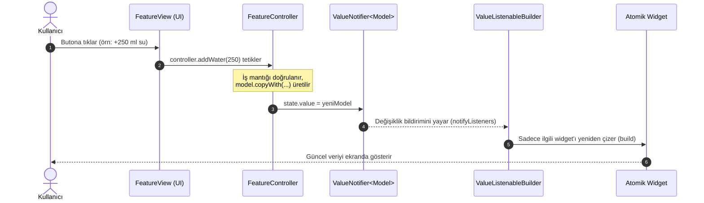

# State Akış Mimarisi ve Reaktif Durum Yönetimi Kılavuzu

Bu doküman, **Susadım (v1)** fitness ve su takip projesinde uygulanan reaktif durum yönetimi (State Management) standartlarını, mimari katmanları ve veri akışını detaylandırmaktadır. Projedeki tüm ekran ve modül geliştirmelerinde bu akış ilkelerine uyulması zorunludur.

---

## 📌 İçindekiler

1. [Mimari Felsefe: Neden ValueNotifier?](#1-mimari-felsefe-neden-valuenotifier)
2. [Uçtan Uca State Akış Şeması](#2-uçtan-uca-state-akış-şeması)
3. [Katmanlar ve Sorumluluk Ayrımı](#3-katmanlar-ve-sorumluluk-ayrımı)
4. [Bellek Yönetimi ve Yaşam Döngüsü (Lifecycle)](#4-bellek-yönetimi-ve-yaşam-döngüsü-lifecycle)
5. [Anti-Pattern ve Doğru Yaklaşım Karşılaştırması](#5-anti-pattern-ve-doğru-yaklaşım-karşılaştırması)
6. [Tasarım Sistemi ve Tema Entegrasyonu](#6-tasarım-sistemi-ve-tema-entegrasyonu)
7. [Birim Test Standartları](#7-birim-test-standartları)

---

## 1. Mimari Felsefe: Neden ValueNotifier?

Projemizin kırmızı çizgilerinde belirtildiği üzere, dışarıdan kontrolsüz ağır state paketleri (Bloc, MobX vb.) yerine **Flutter'ın yerel çekirdek API'si** olan `ValueNotifier` ve `ValueListenableBuilder` tercih edilmiştir.

### Sayfa Düzeyinde `setState` Neden Yasaktır?
- **Gereksiz Rebuild Maliyeti:** `setState` çağrıldığında, `build(BuildContext context)` metodu altındaki tüm widget ağacı (statik başlıklar, kartlar, butonlar vb.) yeniden oluşturulur. Bu durum karmaşık sayfalarda 60/120 FPS akıcılığını bozar ve frame düşüşlerine (jank) yol açar.
- **Spagetti Kod:** UI kodu ile iş mantığı (business logic) iç içe geçer; test yazımı ve kod okunabilirliği imkânsızlaşır.
- **Tek Noktadan Kontrol Eksikliği:** Birden fazla widget aynı durumu paylaşmak istediğinde `setState` yetersiz kalır.

### `ValueNotifier` ve `ValueListenableBuilder` Avantajları:
- **Noktasal (Granular) Güncelleme:** Yalnızca `ValueListenableBuilder` ile sarılan hedef widget yeniden çizilir; sayfanın geri kalanı tamamen statik kalır.
- **Sıfır Dış Bağımlılık:** `flutter/foundation.dart` içinde yer aldığından ek paket ve versiyon uyumsuzluğu riski taşımaz.
- **Kolay Test Edilebilirlik:** Controller sınıfları saf Dart sınıflarıdır; Flutter UI'ına ihtiyaç duymadan saniyeler içinde birim testi yazılabilir.

---

## 2. Uçtan Uca State Akış Şeması

Aşağıdaki Mermaid diyagramı, kullanıcı etkileşiminden UI güncellemesine kadar gerçekleşen tek yönlü veri akışını (Unidirectional Data Flow) göstermektedir:



---

## 3. Katmanlar ve Sorumluluk Ayrımı

Proje **Özellik Bazlı (Feature-Based)** mimariyi benimser. Her klasörün net bir görevi vardır:

### 1. Model Katmanı (`models/<feature>_model.dart`)
- **Değişmezlik (Immutability):** Tüm alanlar `final` tanımlanmalıdır.
- **`copyWith` Metodu:** Durum güncellemelerinde mevcut nesnenin yeni bir kopyasını oluşturmak için zorunludur.
- **Serileştirme:** `fromJson` ve `toJson` fabrika metotları eksiksiz yazılmalıdır.
- **Türetilmiş Alanlar (Getters):** UI hesaplamalarını kolaylaştıracak yardımcı getter'lar (örn: `progressRatio`, `isGoalReached`) modele eklenmelidir.

### 2. Controller Katmanı (`controllers/<feature>_controller.dart`)
- Durumu `ValueNotifier<T>` nesnesi içinde saklar.
- İş kurallarını (business logic), limit kontrollerini ve veri manipülasyonunu üstlenir.
- UI bileşenlerinden tamamen bağımsızdır (`BuildContext` parametresi almaz).
- Yaşam döngüsü sona erdiğinde belleği serbest bırakmak için `dispose()` metodu içerir.

### 3. View Katmanı (`views/<feature>_view.dart`)
- Ekran iskeletini (`Scaffold`, `AppBar`, `SafeArea`) oluşturur.
- Controller'ı başlatır ve yaşam döngüsünü yönetir.
- Durum gerektiren bölgeleri `ValueListenableBuilder` ile sarar.
- Kesinlikle iş mantığı içermez; olayları doğrudan controller metotlarına delege eder.

### 4. Widget Katmanı (`widgets/<feature>_widgets.dart`)
- 40 satırı geçen `build` metotlarının parçalandığı atomik bileşenlerdir.
- Statik parametreler için `const` constructor zorunludur.
- Renkler ve tipografiler doğrudan tema nesnesinden (`Theme.of(context)`) alınır.

---

## 4. Bellek Yönetimi ve Yaşam Döngüsü (Lifecycle)

`ValueNotifier` dinleyicileri bellek sızıntısına (memory leak) yol açmamak için mutlaka `dispose` edilmelidir.

```dart
class WaterTrackerView extends StatefulWidget {
  const WaterTrackerView({super.key});

  @override
  State<WaterTrackerView> createState() => _WaterTrackerViewState();
}

class _WaterTrackerViewState extends State<WaterTrackerView> {
  // 1. Controller initState anında güvenle ayağa kaldırılır
  late final WaterTrackerController _controller;

  @override
  void initState() {
    super.initState();
    _controller = WaterTrackerController();
  }

  // 2. Ekrandan çıkıldığında controller ve notifier'lar imha edilir
  @override
  void dispose() {
    _controller.dispose();
    super.dispose();
  }

  @override
  Widget build(BuildContext context) {
    // 3. UI yalnızca ValueListenableBuilder ile hedeflenerek çizilir
    return Scaffold(
      body: ValueListenableBuilder<WaterTrackerModel>(
        valueListenable: _controller.state,
        builder: (context, state, _) {
          return WaterProgressCard(data: state);
        },
      ),
    );
  }
}
```

---

## 5. Anti-Pattern ve Doğru Yaklaşım Karşılaştırması

### ❌ Yanlış Yaklaşım (Anti-Pattern):
```dart
// YANLIŞ: Ağır setState kullanımı ve monolitik devasa build metodu
class BadWaterScreen extends StatefulWidget {
  @override
  _BadWaterScreenState createState() => _BadWaterScreenState();
}

class _BadWaterScreenState extends State<BadWaterScreen> {
  int currentWater = 0; // Model yok

  @override
  Widget build(BuildContext context) {
    // 150 satırlık devasa ağaç, her tıklamada her şey baştan render edilir
    return Scaffold(
      appBar: AppBar(title: Text('Su Takibi')),
      body: Column(
        children: [
          Text('Su: $currentWater ml'),
          ElevatedButton(
            onPressed: () {
              setState(() {
                currentWater += 250; // Doğrudan UI içinde state mutasyonu
              });
            },
            child: Text('Ekle'),
          ),
        ],
      ),
    );
  }
}
```

### ✅ Doğru Yaklaşım (Proje Standardı):
- **Model:** `WaterTrackerModel` (Immutable, copyWith, toJson, fromJson).
- **Controller:** `WaterTrackerController` (ValueNotifier, addWater, resetWater, dispose).
- **View:** `WaterTrackerView` (ValueListenableBuilder ile yalnızca ilerleme kartı render edilir).
- **Widgets:** `WaterProgressCard`, `WaterQuickActions` (< 40 satır, const).

---

## 6. Tasarım Sistemi ve Tema Entegrasyonu

Susadım v1 projesi **Material 3** ve **Dark Obsidian & Neon Cyan/Lime** paletini temel alır:

- **Arka Plan:** Koyu Grafit / Obsidian (`#12161A`)
- **Vurgu Rengi (Accent):** Neon Cyan (`#00E5FF`) ve Neon Lime (`#76FF03`)
- **Kart Yüzeyleri:** Hafif aydınlatılmış koyu yüzey (`#1E252B`)

### Tema Kuralı:
Widget'larda kesinlikle `Colors.blue` gibi rastgele renkler kullanılmaz.
```dart
// DOĞRU:
final theme = Theme.of(context);
final primaryColor = theme.colorScheme.primary;

// YANLIŞ:
final color = Color(0xFF00FF00); // Yasak
```

---

## 7. Birim Test Standartları

State katmanının ayrılmış olması birim test yazmayı son derece hızlandırır. Controller testleri UI mocklamaya ihtiyaç duymadan çalıştırılır:

```dart
import 'package:flutter_test/flutter_test.dart';
import 'package:susadim/features/water_tracker/controllers/water_tracker_controller.dart';

void main() {
  group('WaterTrackerController Testleri', () {
    late WaterTrackerController controller;

    setUp(() {
      controller = WaterTrackerController(initialGoal: 2000);
    });

    tearDown(() {
      controller.dispose();
    });

    test('addWater çağrıldığında miktar doğru artmalı ve bildirim yaymalı', () {
      expect(controller.state.value.currentWaterMl, 0);

      controller.addWater(250);
      expect(controller.state.value.currentWaterMl, 250);

      controller.addWater(500);
      expect(controller.state.value.currentWaterMl, 750);
    });

    test('resetWater çağrıldığında su sıfırlanmalıdır', () {
      controller.addWater(500);
      controller.resetWater();
      expect(controller.state.value.currentWaterMl, 0);
    });
  });
}
```

---

## 📋 Özet Kural Listesi

| Kural | Durum | Açıklama |
|---|---|---|
| Sayfa genelinde `setState` | ❌ Yasak | Reaktif `ValueNotifier` zorunludur. |
| 40 satırı geçen `build` metotları | ❌ Yasak | `widgets/` altına parçalanmalıdır. |
| `const` constructors | ✅ Zorunlu | Tüm statik widget'larda bulunmalıdır. |
| `dispose()` çağrısı | ✅ Zorunlu | Tüm Notifier'lar temizlenmelidir. |
| `flutter analyze` uyumu | ✅ Zorunlu | 0 uyarı ve 0 hata ile geçmelidir. |
